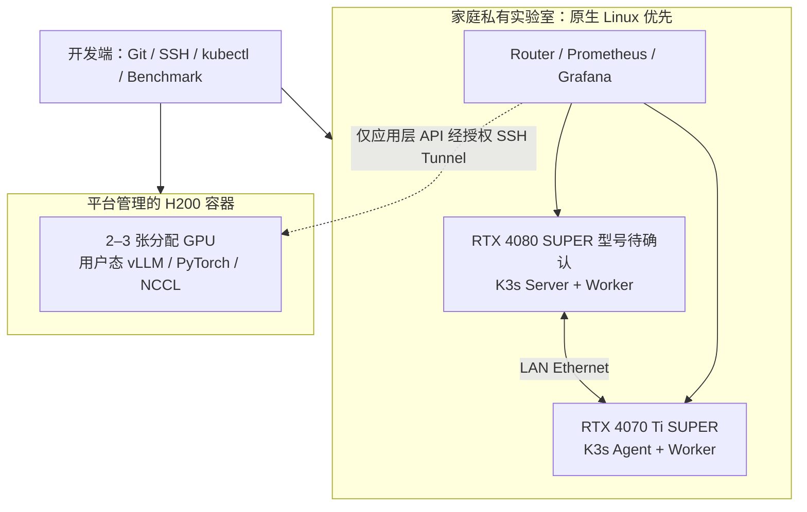

# Day 00 — Infrastructure Bootstrap · 家庭 RTX 双机与云端 H200

先确认你所在的机器能承担哪一种实验，再运行 Day 01 的第一条真实请求。今天的交付是有 Run ID 的环境记录，以及一张清楚标出已验证和待验证能力的清单。家庭集群和云端多卡可以分开准备。[28 天课程](../README.md) · [软件环境](../../environments/README.md) · [实验协议](../../docs/experiment-protocol.md)

## 1. 实验环境与职责



| Profile | 用途 | 权限 / 限制 |
|---|---|---|
| home-4070 | 模型原理、Mini Engine、CUDA/Triton | 单卡；原生 Linux 优先，WSL2 可承担单卡练习 |
| home-4080 | 同模型基线、异构 GPU 性能 | 暂按 4080 SUPER 规划，实际型号需核对 |
| home-cluster | 双节点 K3s、GPU Pod、llm-d、监控、故障恢复 | 仅自己有权管理的主机与集群 |
| cloud-h200-single | Hopper、FP8、KV Cache、Prefill/Decode、Profiling | SSH 容器用户态；禁止宿主机变更 |
| cloud-h200-multi | TP/DP、NCCL、P/D 分离 | 优先两卡同容器；第三卡可选；必须实测权限和链路 |
| hybrid | 异构/混合云智能路由与 Agent 工作负载 | 仅 API 级连接；不跨互联网执行 TP 或传递 KV |

`ENV` 是 Python 软件依赖环境，`PROFILE` 是硬件、网络及权限描述，两者独立。JSON 中的 GPU 数量是目标，不是探测结果。容器 root 不等于宿主机 root；不从 NVML 可见设备数量推断平台授权。

## 2. Day 0 只读盘点（不要阻塞 Day 01–05）

从仓库根目录执行。探测脚本依赖 Python 3.9+ 标准库，不安装软件，不修改配置，不输出 SSH 凭证、IP 或 GPU UUID；若选用 `--torch` 则探测当前 Python 环境的 PyTorch CUDA 可见性。输出使用新文件路径，已有文件不会覆盖。环境报告仍可能含设备型号等信息，公开提交前检查。

```bash
LAB=environments/lab-topology
python "$LAB/scripts/doctor.py" --profile home-4070 --torch
python "$LAB/scripts/doctor.py" --profile home-4080 --torch
# 在云端平台分配的容器内部运行：
python "$LAB/scripts/doctor.py" --profile cloud-h200-multi --torch \
  --output runs/day00-h200-001/environment.json
```

通过仓库入口保存正式记录：

~~~bash
make doctor ENV=pytorch PROFILE=cloud-h200-multi ARGS="--torch"
make lab DAY=00 ENV=pytorch PROFILE=cloud-h200-multi
# 在平台明确分配给本容器的 GPU 上，执行真实运算
make lab DAY=00 ENV=pytorch PROFILE=cloud-h200-single ARGS="--smoke cuda"
# 安装并启动 Day 01 固定模型服务后，从同一节点发出一次真实请求
make lab DAY=01 ENV=cpu PROFILE=cloud-h200-single IMPL=reference ARGS="--warmup 0 --repeat 1"
~~~

inventory 运行成功只代表盘点已完成。observed 表示读到设备或资源信息；untested 表示尚无冒烟证据；blocked 表示探测或已尝试的冒烟被阻塞；passed 仅由完成断言的实际冒烟产生。每个 Run ID 独立，保留 CUDA 运行与同一节点真实模型响应两个 Run ID 以及服务端启动日志，才勾选 Day 00 最低门槛。

以上三个独立 doctor 命令应分别在对应主机执行，而不是在一台主机上假装有三种环境。实际报告保存在现有 Run ID 目录，`runs/day00-h200-001` 仅示例，重跑改用新目录。`--torch` 必须在已有依赖环境中运行。

另在自己有授权的终端检查 `nvidia-smi -L`、`nvidia-smi topo -m`、`nvidia-smi nvlink -s`、`df -h /dev/shm`、`ulimit -l`，注意输出可能带真实 UUID、主机标识等。云平台可能屏蔽命令，记录失败即可；不要改驱动或扩大可见卡。`torch.cuda.is_available()` 只说明可见性，不证明 CUDA workload、NCCL、P2P、RDMA 或 Profiler 性能计数器可用。

Day 0 最低通过门槛：**至少一个授权 GPU 环境能执行 PyTorch CUDA 运算和课程 Day 01 的 vLLM API 冒烟测试**。其他环境准备可以在前三周并行完成，失败时明确阻塞原因。GPU 正确性测试示例（实际运行会使用 CUDA）：

```bash
python -c 'import torch; x=torch.arange(8,device="cuda"); assert x.sum().item()==28; print("CUDA smoke passed")'
```

## 3. 家庭网络与 Linux

建议原生 Ubuntu 22.04/24.04 LTS，两个不同 hostname，路由器 DHCP 保留地址、有线 LAN。Windows/WSL2 不强制重装：先跑单卡和 CPU Kubernetes；实际双节点 GPU K3s 需原生 Linux 或经独立验证的 GPU VM/WSL 方案。先备份，操作系统安装由用户决定。

在两台家庭主机确认 CPU/RAM/磁盘余量；控制平面放在更稳定且 RAM 富裕的主机，另一台作 Agent；两节点不是 HA 控制平面。选择不与 LAN/VPN 重叠的 Pod/Service CIDR。通过 `ip -br addr`、`ip route`、`ethtool <iface>` 和 `iperf3` 验证实际链路。安装工具仅在自有机器经确认后执行：

```bash
sudo apt update
sudo apt install openssh-server iperf3 ethtool
sudo systemctl enable --now ssh
# 主机 A（在可信 LAN 内临时启动）：
iperf3 -s -B <HOST_A_LAN_IP>
# 主机 B：
iperf3 -c <HOST_A_LAN_IP> -t 10
iperf3 -c <HOST_A_LAN_IP> -t 10 -R
ping -c 20 <HOST_A_LAN_IP>
```

尖括号均为待替换的占位符，不能原样复制。结束后关闭 iperf3 server。保留延迟和双方向有效带宽，防火墙只允许实验设备必要的 LAN 通信，不开放 WAN；遵循 [K3s 网络要求](https://docs.k3s.io/installation/requirements)。

## 4. Docker / GPU Container（Day 21 前）

按实际驱动、操作系统、版本选择官方安装方案：[Docker Ubuntu](https://docs.docker.com/engine/install/ubuntu/)；[NVIDIA Container Toolkit](https://docs.nvidia.com/datacenter/cloud-native/container-toolkit/latest/install-guide.html)。先宿主机 `nvidia-smi`，再 Docker GPU 容器。仅在有管理权的家庭主机修改 Docker 配置（会重启 Docker，先停止/通知现有服务）：

```bash
sudo nvidia-ctk runtime configure --runtime=docker
sudo systemctl restart docker
# CUDA_IMAGE 用已核对兼容的 NVIDIA CUDA 镜像完整 digest
sudo docker run --rm --gpus all "$CUDA_IMAGE" nvidia-smi
```

Docker 镜像版本以仓库现有 vLLM 版本锁和官方兼容矩阵为准，不使用 latest；拉取指定版本后 `docker image inspect` 获取 RepoDigests，记录镜像 digest。Docker `--gpus all` 只在各一张、授权自有的家庭机器执行，不在平台容器执行。K3s 默认独立 containerd，Docker 测试不能替代 Pod GPU 测试。

## 5. 家庭 K3s / GPU Device Plugin（Day 22–23）

安装前核对 [K3s 官方 Quick Start](https://docs.k3s.io/quick-start)；根据兼容矩阵固定同一个 `INSTALL_K3S_VERSION`，安装 NVIDIA Container Toolkit/Runtime 后再启动 K3s，避免错误覆盖已有 containerd 配置。准备 K3s 版本、节点 IP、接口和防火墙；不采用一键脚本自动重装系统。

在主机 A（无现有需要保留的 K3s 集群）执行：

```bash
# 先自行设置并核对 K3S_VERSION 为正式版本，如 vX.Y.Z+k3sN
: "${K3S_VERSION:?set verified K3s version}"
curl -fsSL https://get.k3s.io -o install-k3s.sh
# 先阅读脚本、官方版本与网络要求；仅确认后执行
sudo env INSTALL_K3S_VERSION="$K3S_VERSION" sh install-k3s.sh
sudo k3s kubectl get nodes
```

从 A 安全获取 agent join token（敏感凭据，不提交 Git、不粘贴到日志）。B 设置相同 `K3S_VERSION`、`HOST_A_IP`，通过受信通道将 token 放入 B 上仅 root 可读、可持续保留的文件，并设置 AGENT_TOKEN_FILE 为其绝对路径：

```bash
: "${K3S_VERSION:?set verified K3s version}"
: "${HOST_A_IP:?set actual LAN IP}"
curl -fsSL https://get.k3s.io -o install-k3s.sh
# 先阅读脚本；只在自己的实验主机执行
: "${AGENT_TOKEN_FILE:?set path of private agent token file}"
sudo test -s "$AGENT_TOKEN_FILE"
sudo env INSTALL_K3S_VERSION="$K3S_VERSION" \
  K3S_URL="https://${HOST_A_IP}:6443" K3S_TOKEN_FILE="$AGENT_TOKEN_FILE" sh install-k3s.sh
unset AGENT_TOKEN_FILE
```

限制 token 文件的读取权限，保留其路径供 Agent 服务重启时使用。配置 kubeconfig 到开发端时使用安全通道、限制文件权限、确认证书 SAN；不要放进仓库或分享管理员 kubeconfig。所有以下 `kubectl`、`helm` 命令使用明确的家庭集群 context（`HOME_CTX`）和自己的权限。先只读检查，再授权变更：

```bash
: "${HOME_CTX:?set exact home kube context}"
kubectl --context "$HOME_CTX" get nodes -o wide
kubectl --context "$HOME_CTX" get runtimeclass
# 确认两台是自有实验节点，runtimeClass nvidia 或实际兼容的 runtime
helm repo add nvdp https://nvidia.github.io/k8s-device-plugin
helm repo update
helm search repo nvdp/nvidia-device-plugin --versions
```

若集群已有 Device Plugin 或 GPU Operator，复用已有部署，不重复安装。否则核对 Chart 版本和实际 `runtimeClassName`，再安装（会创建集群组件）：

```bash
: "${DEVICE_PLUGIN_VERSION:?set verified Helm chart version}"
helm --kube-context "$HOME_CTX" upgrade --install nvdp nvdp/nvidia-device-plugin \
  --version "$DEVICE_PLUGIN_VERSION" --namespace nvidia-device-plugin \
  --create-namespace --set runtimeClassName=nvidia
kubectl --context "$HOME_CTX" get nodes \
  -o 'custom-columns=NAME:.metadata.name,GPU:.status.allocatable.nvidia\.com/gpu'
# 确认名称后只标记家庭实验节点
kubectl --context "$HOME_CTX" label node "$HOME_NODE_A" "$HOME_NODE_B" inference-lab/gpu-home=true
python "$LAB/scripts/doctor.py" --profile home-cluster --kube-context "$HOME_CTX"
```

`HOME_NODE_A` / `HOME_NODE_B` 必须先设置为实际不同节点名。不要开 MIG、time-slicing、MPS；这里需要两张独立卡各自调度。Allocatable 代表节点总可分配容量而不是当前空闲量。官方：[K3s NVIDIA Runtime](https://docs.k3s.io/advanced#nvidia-container-runtime)；[NVIDIA Device Plugin](https://github.com/NVIDIA/k8s-device-plugin)。

## 6. 家庭双副本 vLLM 部署模板

渲染工具生成 Namespace + Deployment + ClusterIP Service，默认每个 Pod 独占一张 GPU、同模型双副本、硬性 Pod anti-affinity、Startup/Readiness Probe、4GiB `/dev/shm`、临时模型缓存，不暴露公网、禁用 ServiceAccount 自动挂载。默认 BF16、4K context、max-num-seqs=8、memory-util=0.8。按桌面显存空余调整；不保证 4B 在所有设置下运行，先用 0.6B 冒烟。**临时模型缓存不是生产权重存储**：重建 Pod 会再次下载，Day 24 再使用每节点 PVC / 本地存储或合法共享存储；主机系统盘要留空间。GPU 显存和宿主机共享内存不同。

渲染器默认选取 vllm/vllm-openai:v0.34.0 的 Linux amd64 manifest digest，并从 Day 01 的模型表取模型和 tokenizer revision。配置显式调用 vllm serve。先在仓库根生成 0.6B 的单副本清单，再人工核对目标环境。[Day 01 模型表](../day-01/config/revisions.json) · [官方镜像标签](https://hub.docker.com/r/vllm/vllm-openai/tags?name=v0.34.0)

```bash
make render-k8s ARGS="--model Qwen/Qwen3-0.6B --replicas 1" > /tmp/inference-lab-manifest.json
# 审阅；检查目标 context 和已存在资源（若冲突，先合并而非覆盖）
kubectl --context "$HOME_CTX" get namespace inference-lab
# get namespace 未找到时属正常；确认后部署
kubectl --context "$HOME_CTX" apply -f /tmp/inference-lab-manifest.json
kubectl --context "$HOME_CTX" -n inference-lab rollout status deployment/vllm-home-lab --timeout=30m
kubectl --context "$HOME_CTX" -n inference-lab get pods -o wide
kubectl --context "$HOME_CTX" -n inference-lab port-forward --address 127.0.0.1 svc/vllm-home-lab 8000:8000
# 另一个终端
curl -fsS http://127.0.0.1:8000/v1/models
```

切换到 4B 时用 `--model Qwen/Qwen3-4B` 重新渲染，对应的两个 revisions 随之切换。再做 4B 的单副本与双副本；仅在确认第二张 GPU 可用后，执行 `kubectl --context "$HOME_CTX" -n inference-lab scale deployment/vllm-home-lab --replicas=2`。通过节点分布和实际每个 Pod 的请求验证独立 GPU。使用 `port-forward svc/...` 通常只会选中一个 Pod，因此**不能以这个连接测量双副本 Service 负载均衡**；用分别转发两个 Pod 的端口并在本地 Router 进行请求分发，或使用经授权的集群内客户端/Gateway，保留每次真实后端 ID。

Recreate 更新策略会有停机，原因是仅两张卡，没有第三张用于滚动更新；学习 Day 25 时将其作为冷启动/可用性实验。未配置鉴权的 ClusterIP 仍可能被其他 Pod 访问，只用于可信私有实验集群；共享环境必须配置 API key、网络隔离、RBAC/TLS。不得暴露 NodePort/公网。卸载时先确认资源标签及归属，针对本次 Deployment/Service 删除，禁止无条件删除共享 namespace。

## 7. 云端 H200：保留平台边界（Day 18–20）

仅使用平台提供的 SSH 容器、用户态 Python/CUDA/推理工具链。保留平台设置的 CUDA_VISIBLE_DEVICES，不通过设备文件或修改 env 扩大访问范围。优先申请同时分配 2–3 张完整 GPU 的单容器；如果平台只提供多个单卡容器，只有平台明确允许跨容器网络、IPC/RDMA 后才做真实跨节点实验。

在平台确认当前容器拥有两张实验 GPU后：

```bash
# 仅正确性测试，不是带宽 benchmark
# torchrun 来自课程已安装的 PyTorch 环境
# 保留平台 CUDA_VISIBLE_DEVICES；失败后查看平台权限与日志
make lab DAY=00 ENV=pytorch PROFILE=cloud-h200-multi ARGS="--smoke nccl --gpus 2"
```

成功表示两进程 AllReduce 正确，不证明 NVLink 可用。随后使用官方 [NCCL Tests](https://github.com/NVIDIA/nccl-tests) 做消息大小/带宽/延迟测试并记录实际 P2P 拓扑。`nsys`、`ncu` 权限不足时保留错误，用 CUDA Events/PyTorch Profiler 替代；不要修改宿主机计数器权限、挂载设备或要求特权容器。

Day 19 比较 Qwen3-32B BF16 的 TP1、TP2、两个 TP1 副本（同模型、同版本、同负载、同精度）；报告 Goodput/GPU 和资源消耗；TP2/双副本/P-D 实验须两张授权且可同时使用的 GPU。同容器 TP2 可用 vLLM 的 multiprocessing 后端，具体参数以锁定版本帮助为准。Day 20 比较两个聚合副本与 1P1D；若连接器、网络或权限不足，记录 blocked，改做单卡 Chunked Prefill/Prefix Cache 及家庭 LAN KV 传输成本实验，明确不等价。三卡用于 1P2D/2P1D/三副本，禁止默认 TP3。

## 8. 混合云：仅 API 级联接（Day 28）

家庭控制端有权连接云端容器时，在云端启动 Day 01 固定版本的 vLLM（监听 127.0.0.1:8000）。在运行 Router 的家庭主机建立授权 SSH Tunnel：

```bash
ssh -N -o ExitOnForwardFailure=yes -o ServerAliveInterval=30 \
  -L 127.0.0.1:18000:127.0.0.1:8000 "$CLOUD_SSH_ALIAS"
# 另一终端
curl -fsS http://127.0.0.1:18000/v1/models
```

按平台实际 SSH 端口、跳板与允许的转发方式调整。不要关闭 SSH host key 验证，不把私钥、token、平台地址存入 Git。若转发被禁用，采用平台官方授权 API 代理或分别在两端运行同一个 Benchmark；不绕过平台限制。Router 初期运行在建立 Tunnel 的宿主机，Pod 的回环地址不等于宿主机回环地址。家庭与云端不组成同一 K8s 集群；不跨 WAN 执行 TP 或 KV Transfer。Cloud Burst 只有在平台授权的资源申请 API 可用时才算自动资源扩缩容，否则是预分配云端服务的路由切换实验。

已有两端服务且完成转发后，在建立隧道的家庭宿主机执行：

~~~bash
make lab DAY=28 ENV=cpu PROFILE=hybrid IMPL=reference ARGS="--home-port 8000 --cloud-port 18000 --route round-robin"
~~~

分别用 `--route home` 与 `--route cloud` 重放同一份负载，记录三个 Run ID。在 round-robin 运行中至少提供两条请求。每行结果的 backend 对应被选中的本地转发端口，需分别关联家庭 Pod 和云容器服务日志才能确认实际处理实例。两侧固定同一已加载的模型 ID、模型与 tokenizer revision、生成配置、缓存状态。以只读的主机别名提供已授权的 SSH 目标；使用平台代理时让授权代理在本机回环端口终止。回放器只连接两个不同的回环端口，拒绝跟随重定向。上线检查要验证真实 API 响应、隧道授权和后端日志，回环 fixture 仅能验证客户端路径。

<a id="environment-map"></a>
## 9. 逐日实验调度与失败降级

| Days | 默认环境 | 验收 / 替代方案 |
|---|---|---|
| 01–05 | home-4070 或任一可用 GPU | CPU 正确性 + 真实 CUDA API；不等集群 |
| 06–12 | 家庭单卡 + H200 单卡 | KV Cache、Prefill/Decode、调度、前缀复用；同 Qwen3-4B 可比较 |
| 13–17 | RTX + H200 | CUDA/Triton、FlashAttention/FlashDecoding、BF16/FP8、投机解码；后端兼容性检查 |
| 18–20 | H200 多卡 | NCCL、TP/DP、P/D；失败记录 blocked；家庭 LAN 纯通信为独立实验 |
| 21–25 | home-cluster | Docker/K3s/GPU Pod/Helm/监控/伸缩；无 GPU K8s 时先 CPU 编排，标注真实 GPU 部署未验收 |
| 26 | H200 容器用户态 | Dynamo 版本支持时运行；否则源码/单进程路由实验 |
| 27 | home-cluster | llm-d / Gateway API Inference Extension；选择与小集群适配的方案，先双副本再 cache-aware |
| 28 | hybrid | 同模型同负载的 home/cloud 路由对照；无网络互通则分环境执行，不能冒充在线 hybrid |

网络、GPU、模型、引擎版本变更时重新建立基线；记录实际 GPU allocated 数量、CUDA visible count、拓扑、驱动、框架/模型 revision、功耗/共享干扰、输入输出长度与缓存状态。保持理论/模拟/实测区分；跨 GPU 性能差异不可只归因于架构，跨网络差异不可只归因于互连。推理优化（KV Cache、Prefill、Decode、Kernel、Scheduler）仍然是核心。

## 自测与验收

- [ ] 解释为何两张 NVML 可见卡、两张平台分配卡、两个 rank 正确求和分别属于不同证据。
- [ ] 给出一个授权 GPU 的 CUDA 求和与 Day 01 流式响应两个 Run ID。设备尚未到位时记录阻塞，先完成 CPU 课程。
- [ ] 在家庭集群保存单/双副本清单、两个节点的分布和分别直达各 Pod 的响应。记录镜像 digest、模型 revision 和 context 的本地核对结果。
- [ ] 多卡实验保存两 rank 的 AllReduce 值；用独立的 NCCL Tests 测带宽。混合路由保存 home/cloud 选择及两侧服务证据。

挑战：家庭 Service 可经单个端口转发返回成功时，设计一个能证实第二个 Pod 也实际处理请求的观测，而不依赖 Service 的 DNS 名称。
